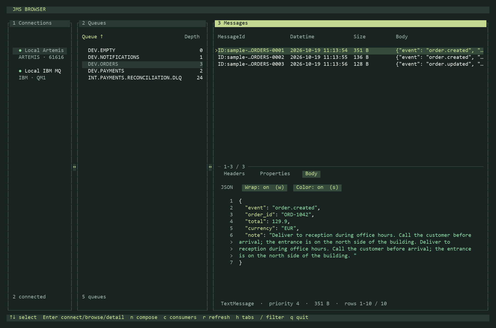
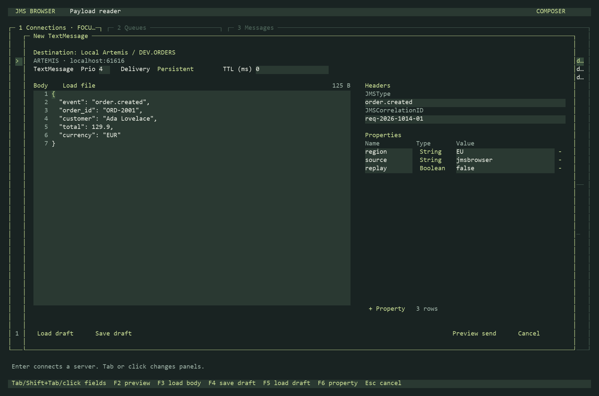

# JMS Browser

Python curses queue browser for **IBM MQ** and **Apache Artemis**, implementing
option 3's payload-reader layout. Browse messages without removing them from queues.
Compose and explicitly send TextMessages to configured queues on either provider.
The right panel shows **MessageId, Datetime, Size, Body** and a selected
message's body, headers and properties below the table.
Datetime uses `JMSTimestamp` in local time as `YYYY-MM-DD HH:MM:SS`; a missing,
unset or invalid timestamp displays `n/a`.



## Install and run

Python 3.11+ is required. Real broker connections use JMS provider clients through
JPype and require a JVM. `jdk4py` in `requirements.txt` supplies a private runtime
inside the virtual environment; an existing Java 21+ installation with `JAVA_HOME`
also works.

Windows PowerShell:

```powershell
python -m venv .venv
.\.venv\Scripts\python.exe -m pip install -r requirements.txt
.\.venv\Scripts\python.exe -m jmsbrowser --install-clients
.\.venv\Scripts\python.exe run.py
```

Linux/macOS:

```sh
python3 -m venv .venv
source .venv/bin/activate
pip install -r requirements.txt
python -m jmsbrowser --install-clients
python run.py
```

`requirements.txt` explicitly lists the runtime packages, including the bundled
Java runtime and a Windows-only marker for `windows-curses`. Run the application
from this checkout with `python run.py`, or use `python -m jmsbrowser` with your
own configuration. Run the commands below from the project directory. If you
use your own Java 21+ installation, you can omit the `jdk4py` line from the
requirements.

The Java client JARs are downloaded separately by `--install-clients`; they are
not installed by `requirements.txt` or included in a Git clone. If a proxy blocks
the download, use [offline JMS client installation](#offline-jms-client-installation).

Start the broker containers separately from the project directory:

```sh
docker compose up -d
```

Or start the same broker fixtures with the Podman Compose file:

```sh
podman compose --file compose.podman.yaml up -d
```

Start the browser directly with Python on Windows:

```powershell
.\.venv\Scripts\python.exe run.py
```

With an activated virtual environment (Windows, Linux or macOS):

```sh
python run.py
```

`run.py` loads `config.example.yaml`, including its development passwords,
and starts only the browser.
It does not start or stop containers. Additional browser options work as usual,
for example `python run.py --connection "Local IBM MQ" --queue DEV.ORDERS`.

For another configuration, put its passwords in YAML and invoke the module directly:

```powershell
.\.venv\Scripts\python.exe -m jmsbrowser --config config.yaml
```

On Linux/macOS, use `python -m jmsbrowser --config config.yaml`.
Select a server and press Enter to
connect. Tab or a mouse click moves between the three panels. In expanded message
detail, Tab / Shift+Tab cycles Headers, Properties and Body; these tabs are also
clickable in both detail layouts. Headers is selected by default. The message
composer, consumer inspector and expanded message details each have a clickable
**X** in the top-right corner. The composer's file-path dialogs also have an X
that returns to the composer. Closing a composer while sending leaves its
submitted request running; it does not cancel or repeat that request. The message
list and inline detail each occupy half of section 3's height (rounded to whole
terminal rows). Minimum terminal
size is 120 columns × 28 rows; 160 × 46 leaves more room for message contents.

Drag either vertical divider to resize its adjacent panels. The small double
arrow marks the drag area; the bordering cells also accept a drag. Widths are
kept for the current session, with minimum sizes that preserve all message
columns. Double-click either divider to reset the widths; Escape cancels a drag.
Terminal resizing clamps the layout to the available space. The message
list/detail height split remains 50/50.

The active panel has a bright title and an arrow on its selected row. Selections
in other panels stay visible with a quieter background. Mouse movement alone
does not change keyboard focus.

Both Body views use soft wrapping and JSON/XML syntax colors by default.
Expanded message detail always keeps wrapping and colors on and has no toggles.
In inline Body detail, click the Wrap / Color controls or press **w** / **s**
to change these settings. Wrapped continuations use `>` instead of repeating
the line number; scrolling counts the displayed rows. Disable wrapping to scroll
long lines horizontally with **[** / **]**. JSON keeps its existing display
formatting; XML retains its line structure and receives token colors. Plain text
and invalid JSON remain readable text. Inline display settings apply across
messages for the session and leave the message body, headers and properties
unchanged.

Click the data inside Body, Headers or Properties to copy that entire section
to the desktop clipboard. A brief flash and “Copied to clipboard” confirm the
copy in both inline and expanded details. Tabs only navigate; clicking them
does not copy. Scrolling, wrapping, colors and the visible area do not limit
what is copied. Body copies the original text (without display line numbers or
JSON prettification); headers and properties copy the complete key/value table.
If a body exceeds the preview limit, the application re-reads that message with
a non-consuming QueueBrowser before copying. Switching messages or tabs cancels
a pending copy. An unavailable message or clipboard shows a copy error in the
detail section. Windows uses its native clipboard and macOS uses `pbcopy`; Linux
requires `wl-clipboard` on Wayland or `xclip` / `xsel` on X11.

| Key | Action |
| --- | --- |
| Tab / Shift+Tab | Change panel focus; in expanded detail, cycle detail tabs |
| Mouse click | Focus panels, select rows, activate detail tabs or inspector controls |
| Click detail data | Copy the complete Body, Headers or Properties section and briefly flash it |
| Click Queue / Depth header | Sort queues by name / numeric depth; click the same header again to reverse |
| Mouse drag on a vertical divider | Resize the adjacent panels |
| Double-click a divider / Escape during drag | Reset widths / cancel the drag |
| Up / Down | Select connection, queue or message |
| Left / Right | No action in connection, queue or message lists |
| Home / End | First / last matching row |
| Enter | Connect server; in queues load messages and refresh the selected depth; in messages expand / restore detail |
| d | Disconnect selected server |
| PgUp / PgDn, mouse wheel over detail | Scroll payload / headers / properties |
| [ / ] | Scroll long detail lines horizontally; disable Body wrapping first |
| w / s in inline Body | Toggle soft wrapping / syntax colors; expanded detail always keeps both on |
| h | Cycle Headers / Properties / Body |
| /, Enter | Edit and apply a filter for the focused panel |
| Escape | Return from full screen or clear focused filter |
| r in queues | Refresh depths for all queues without reloading messages |
| r in connections/messages | Refresh queues and messages |
| c | Open consumer inspector for the selected queue, including empty queues |
| n | Open the TextMessage composer for the selected queue |
| Inspector Up / Down, PgUp / PgDn | Select consumers; scroll when viewing consumer details |
| Inspector Enter | Show full consumer, connection, session and selector details |
| Inspector c / Refresh consumers | Refresh only consumer metadata; r has no action here |
| Inspector Tab / Shift+Tab | Focus list, Refresh consumers or X |
| Inspector Escape / X | Return from details to list, then close; X closes immediately |
| q / Ctrl+C | Quit, clear the curses screen and restore the terminal cursor |

The green dot follows a live provider connection. Each connection has an isolated
worker process, so networking and Java calls do not block terminal navigation.
Requests have a configurable deadline; a stuck worker is terminated and can be
reconnected. Delayed results for a previously selected queue are discarded.
Queue-depth refreshes keep focus and message selection in place. Selecting a
queue with Up / Down, Home / End or a single mouse click does not query messages.
Changing queues clears the previous messages and shows a prompt to press Enter.
Enter on a queue loads its messages, refreshes only that queue's depth, and keeps
the queue panel focused; double-clicking a queue performs the same action.
Connecting a server initially lists queues without loading messages, unless
`--queue` explicitly requests an initial queue. Refreshing queue depths with `r`
does not load messages; refreshes from the other panels reload messages only
after that queue has been opened. Routing labels and the
connection/queue breadcrumb line are omitted from the screen.
The panels extend down to the keyboard shortcut bar; the separate bottom status
line is omitted.
The selected depth cell displays `...` while its inquiry is pending. Detail-tab
labels retain fixed positions and widths; the active tab uses a background highlight.
The queue panel has no Refresh or Consumers buttons; use the `r refresh` and
`c consumers` shortcuts shown in the bottom bar. In the consumer inspector,
press `c` again to refresh the consumer list.

The consumer list shows **User, Consumer count, Producer count, Remote address,
Creation time**. For Artemis, User and both counts come from the consumer's
matching session. The counts cover the entire session, including consumers on
other queues and browsers; consumers sharing a session repeat its counts. Creation time is
the consumer's creation time, as reported by the broker. Full consumer, session
and connection details remain available with Enter. Unavailable or unauthorized
fields show `n/a`; the IBM MQ handle inquiry does not expose JMS session counts
or consumer creation time. The inspector has one **X** close control, with no
separate text Close button.

Queues default to alphabetical name order, ascending. Click **Queue** or
**Depth** to sort the middle panel; selecting a different column starts ascending,
and clicking the active column toggles descending/ascending. An up/down arrow
marks the active column and direction (`^` / `v` in ASCII mode). Depth sorts
numerically, with equal depths ordered by queue name. Sorting applies to the
filtered list and stays active across refreshes and connection changes for the
session. It preserves the selected queue and loaded messages without querying
the broker; Up / Down follows the displayed order.
Queue depths are displayed in full, with the depth column expanding for larger
counts.

Local refresh timing was checked before and after the latest changes. Windows
tried IPv6 `::1` for `localhost` before falling back to the IPv4-only Compose port,
adding about two seconds per HTTP connection. The example Jolokia URL now uses
`127.0.0.1`. Median selected-queue requests fell from about 2,063 ms to 7 ms;
all-queue requests fell from 4,146 ms to 26 ms. IBM now reuses its inquiry connection
and PCF agent; selected inquiries fell from about 22 ms to 4 ms. These are five-sample
local request timings, excluding JVM startup and time waiting behind other requests.

The consumer inspector implements [consumer display option 2](docs/CONSUMER_OPTIONS.md).
It preserves panel focus, queue/message selection and detail tabs on return.
Artemis lists attached consumers, excluding browse-only sessions, with client,
endpoint, user, protocol, selector and connection/session details when available.
IBM lists **input handles**, with application, endpoint, user, channel and process/thread
details. Those handles do not necessarily represent separate application instances;
selectors and unique handle IDs are not available through the queue-status inquiry.
The inspector distinguishes loading, zero attached and unavailable metadata.
Permissions failures remain in the inspector without disconnecting message browsing.
Consumer metadata refresh is explicit and does not receive business messages.

## Message composer

Select a connected server and queue, then press **n**. The destination stays bound
to that connection and queue while composing. Use Tab / Shift+Tab or click to move
between fields and controls; arrow keys edit text inside the composer. Enter adds
a newline in Body, moves to the next text field, or activates a focused button.
Typing q, c, r or n in a text field enters text.

Set priority (0–9), persistent/non-persistent delivery, TTL in milliseconds
(0 means no expiry), JMSType and JMSCorrelationID. Add or remove typed properties;
click a property's Type or focus it and press Enter/Space to cycle String, Boolean,
Byte, Short, Int, Long, Float and Double. Names, duplicate names and numeric ranges
are validated before sending. Reserved JMS property names use the dedicated
header fields. Body and metadata together are limited to 4 MiB in UTF-8.

- **F2 / Preview send:** review the destination, body, headers and properties.
  No message is sent at this step. Use Up/Down or PgUp/PgDn to review long content.
  Tab/click **Send 1 message**, then Enter/click to send once.
- **F3 / Load file:** load a UTF-8 text file (an optional UTF-8 BOM is removed).
- **F4 / Save draft:** save body, settings, typed properties and destination as
  JSON. Defaults to the ignored local drafts directory. Credentials are excluded;
  existing files are not overwritten. Enter applies a path; Ctrl+U clears it.
- **F5 / Load draft:** restore a saved draft for the same configured destination.
- **F6 / + Property:** add a property row. Tab or mouse wheel reveals additional
  rows on smaller terminals; the minus control removes a row.
- **Escape / Cancel:** leave the review screen for editing, or close the composer.



[Send review screenshot](docs/designs/composer-preview.png).

Sending runs in the broker worker and is not retried automatically. The result
shows the provider-assigned message ID, timestamp and expiry. The selected queue's
depth and message list refresh after success. Browse limits still apply, so a new
message may be outside the loaded portion of a large queue.
If the worker times out or loses the connection during sending, delivery may be
unknown: the result directs you to inspect the queue before sending again and
offers saving the draft instead of an automatic resend. Provider failures before
send dispatch keep the draft available for editing. The composer stays open while
the request is pending.
On restricted brokers, sending additionally requires put/send authority on the
target queue; the local Compose accounts already have it.

## Configuration and message columns

Copy `config.example.yaml` to `config.yaml` or pass `--config`. Configuration is
validated with `--check-config`. Passwords are stored directly in YAML.
Connection types are `artemis` and
`ibm`; default startup is disconnected (`auto_connect: false`).

Use `password` for the broker password, and `management_password` for a
separate Jolokia password. TLS stores use `trust_store_password` and
`key_store_password` inside `tls`:

```yaml
password: "12345678"
tls:
  enabled: true
  trust_store: C:/certs/artemis-truststore.jks
  trust_store_password: "12345678"
```

The old `_env` password fields are no longer supported; remove the `_env` suffix
and replace the variable name with the password itself. Numeric passwords are
accepted with or without quotes; quoting preserves leading zeros.
Jolokia uses the broker password when no separate management password is set.

`queue_pattern` defaults to `"*"`, showing all discovered queues permitted by the
broker account, including names outside `DEV.`. Artemis hides queues marked
`Temporary` by the broker, including temporary reply and subscription queues;
ordinary queues remain visible even when their names contain UUIDs. IBM omits queues whose metadata
inquiry is denied and internal PCF reply queues. All example connections use
this default. To narrow the list,
use `DEV.*` for names starting with `DEV.` or `DEV.ORDERS` for that name.
It does not create queues or filter message
bodies/properties. If `queues` is also configured, names must match both settings.

- **MessageId:** JMS ID, shortened in the table with the ending retained; available
  in full in the detail view and Headers tab.
- **Type:** JMS body type, such as TextMessage, BytesMessage or MapMessage. The
  optional application-defined JMSType is available in Headers.
- **Prio:** JMS priority from 0 through 9.
- **Size:** payload bytes, excluding headers and transport overhead. Text
  is measured in UTF-8 and bytes messages use their actual body length. Map,
  stream and serialized-object encoded sizes are `n/a`, because portable JMS
  does not expose those byte counts. The full size is retained when preview
  content is truncated.
- **Body:** a single-line body preview; the selected payload is shown below.

Headers and Properties display as key/value tables with right-aligned keys and
left-aligned values. Horizontal scrolling moves values while keeping keys fixed.
`JMSTimestamp` retains its raw milliseconds and also shows local datetime with
milliseconds and UTC offset, for example `1791981234567 (2026-10-14 14:33:54.567+02:00)`.
A zero JMS timestamp is marked `not set`. Raw metadata stays unchanged in JSON exports.

JSON text is formatted in the preview while retaining the original raw text.
Bytes are shown in hex; maps and primitive streams are shown as JSON. Object
messages are identified without deserializing their contents. `max_body_bytes`
caps payload bytes included in a preview (hex formatting expands the display);
headers and properties are separate. JMS text providers materialize text
before truncation, so this is not a broker-side read-size limit. Workers use a
256 MiB Java heap. Browse results are a changing view rather than a locked
snapshot; other clients and expiry can change queue contents independently.

Artemis queue discovery uses authenticated Jolokia (`management_url`) and JMS
handles message browsing. Separate management credentials and a CA file can be
configured. IBM uses PCF inquiry and JMS browsing; local development grants the
app account display permission and access to its temporary PCF reply queues.
Those internal request/reply messages are separate from business-queue browsing.
On restricted IBM installations, configure an explicit `queues` list to use
ordinary queue inquiry without PCF discovery. Both paths need browse/inquire
authority on the intended queues. The IBM consumer inspector additionally needs
PCF command/reply access and display authority for queue-status inquiries, even
when an explicit queue list is configured. The local Compose account already has
these permissions. Artemis uses the queue's `listConsumersAsJSON` and optionally
the broker's `listConsumers` management operation to supply connection details;
denied optional enrichment leaves the consumer list visible with a notice.

Optional TLS settings: `enabled`, `trust_store`, `trust_store_password`,
`key_store`, `key_store_password`, and IBM `cipher_suite`. Store paths should
be absolute. Use Java trust/key stores; management HTTPS uses the system CAs or
`management_ca_file`. `timeout_seconds` defaults to 15 per request.

JMS JAR versions and SHA-256 checksums are locked in `jmsbrowser/client-lock.json`.
`--install-clients` downloads and verifies them in `~/.cache/jmsbrowser/clients`;
`JMSBROWSER_CLIENT_DIR` overrides this location. `--doctor` checks runtime/client
availability. Sending is available only through the interactive composer's
explicit review/send flow; JSON and PNG exports remain non-consuming reads.

For non-interactive browsing and exporting the application screen:

```sh
python -m jmsbrowser --config config.example.yaml --connection "Local IBM MQ" --queue DEV.ORDERS --dump
python -m jmsbrowser --config config.example.yaml --queue DEV.ORDERS --screenshot screen.png
```

PNG export requires Pillow (`python -m pip install -r tools/requirements-mockups.txt`) and renders the same grid as
curses from an actual browse result. It closes the connection after exporting.

## Offline JMS client installation

The error `JMS clients missing or damaged` means a required JAR is absent or does
not match its SHA-256 checksum in `jmsbrowser/client-lock.json`. If
`--install-clients` fails because of a proxy or unavailable internet access,
download these exact eight files on a machine that can reach the links and
transfer them to the target machine:

| Provider | Download |
| --- | --- |
| Artemis | [artemis-jms-client-all-2.57.0.jar](https://repo.maven.apache.org/maven2/org/apache/artemis/artemis-jms-client-all/2.57.0/artemis-jms-client-all-2.57.0.jar) |
| Artemis | [slf4j-simple-2.0.17.jar](https://repo.maven.apache.org/maven2/org/slf4j/slf4j-simple/2.0.17/slf4j-simple-2.0.17.jar) |
| IBM MQ | [com.ibm.mq.allclient-9.4.5.0.jar](https://repo.maven.apache.org/maven2/com/ibm/mq/com.ibm.mq.allclient/9.4.5.0/com.ibm.mq.allclient-9.4.5.0.jar) |
| IBM MQ | [javax.jms-api-2.0.1.jar](https://repo.maven.apache.org/maven2/javax/jms/javax.jms-api/2.0.1/javax.jms-api-2.0.1.jar) |
| IBM MQ | [json-20251224.jar](https://repo.maven.apache.org/maven2/org/json/json/20251224/json-20251224.jar) |
| IBM MQ | [bcprov-jdk18on-1.83.jar](https://repo.maven.apache.org/maven2/org/bouncycastle/bcprov-jdk18on/1.83/bcprov-jdk18on-1.83.jar) |
| IBM MQ | [bcpkix-jdk18on-1.83.jar](https://repo.maven.apache.org/maven2/org/bouncycastle/bcpkix-jdk18on/1.83/bcpkix-jdk18on-1.83.jar) |
| IBM MQ | [bcutil-jdk18on-1.83.jar](https://repo.maven.apache.org/maven2/org/bouncycastle/bcutil-jdk18on/1.83/bcutil-jdk18on-1.83.jar) |

On Windows, paste this location into File Explorer:

```text
%USERPROFILE%\.cache\jmsbrowser\clients
```

On Linux/macOS, use:

```text
~/.cache/jmsbrowser/clients
```

Create the folder if necessary and place all eight JARs directly inside it.
Preserve their filenames and do not extract them. If `JMSBROWSER_CLIENT_DIR` is
set, place the files in that directory instead. You can also copy the matching
JARs from a working installation's client cache.

Restart the browser after copying. No `--install-clients` command or internet
access is required to load these clients. Python dependencies and a JVM must
already be installed as described above. To check Java and the JAR checksums
without downloading anything or connecting to a broker, run from the project
directory with the virtual environment activated:

```sh
python -m jmsbrowser --doctor
```

## Proposed next features

The original proposals use example data. Options 1 and 2 remain proposals;
option 3 is now implemented in the composer described above.

1. **JMS selector filtering — recommended first:** browse matching headers and
   properties before applying the result limit, making large queues easier to
   investigate. [Screenshot](docs/designs/feature-1-selector.png).
2. **Queue depth history:** sample and plot queue depths over time, showing backlog
   changes, minimum and maximum. Depth changes alone do not establish send/receive
   rates. [Screenshot](docs/designs/feature-2-history.png).
3. **Message composer — implemented:** write or load a TextMessage, edit priority, persistence,
   expiry and typed properties, then preview the destination before explicitly
   sending. [Screenshot](docs/designs/feature-3-composer.png).

Selectors are supported by the
[JMS QueueBrowser API](https://docs.oracle.com/javaee/7/api/javax/jms/QueueSession.html).
The send controls correspond to
[JMS producer options](https://docs.oracle.com/javaee/7/api/javax/jms/MessageProducer.html).
Regenerate the three proposals with `python -m tools.render_feature_options`.

## Original design alternatives

All three proposals use the same 144-column character grid, sample data and
three-panel flow: connections → queues → messages. They can be implemented with
Python `curses`, with Tab / Shift+Tab and mouse clicks changing panel focus.
Green dots indicate connected servers; hollow dots indicate disconnected servers.
The message preview stays inside the right panel.

| Option | Screenshot | Interaction emphasis |
| --- | --- | --- |
| 1 — Classic inspector | [View](docs/designs/01-classic.png) | Framed panels, queue metadata, message table with preview below. |
| 2 — Compact workbench | [View](docs/designs/02-compact.png) | Single-row lists, minimal borders, more queues/messages visible at once. |
| 3 — Payload reader | [View](docs/designs/03-reader.png) | Selected; implemented with the requested message table replacing the strip. |

These are static, reproducible UI mockups, not screenshots of a running application.
See [the implementation notes](docs/PLAN.md) and the
[YAML configuration](config.example.yaml).

## Local brokers

Use Docker Desktop running Linux containers (or Docker Engine) with Docker
Compose, or Podman with a configured Compose provider. The images are pinned to
verified published tags and use fully qualified registry names. IBM MQ uses the
**Advanced for Developers** image. Both Compose files set `LICENSE=accept`, so
starting either accepts the IBM MQ developer license. Use this setup for local
development.

```sh
docker compose up -d
docker compose ps -a
docker compose logs artemis-seed ibm-seed artemis-loadtest-seed
python -m tools.verify_brokers
```

For Podman, use [compose.podman.yaml](compose.podman.yaml), located beside the
Docker `compose.yaml`. It defines the same brokers, health checks, sample queues,
seeding services, secrets and named volumes:

```sh
podman compose --file compose.podman.yaml up -d
podman compose --file compose.podman.yaml ps -a
podman compose --file compose.podman.yaml logs artemis-seed ibm-seed artemis-loadtest-seed
podman compose --file compose.podman.yaml down
```

Install Podman 4.7+ and [set up a Compose provider](https://podman-desktop.io/docs/compose/setting-up-compose)
first. On Windows/macOS, create and start a Podman machine (Podman Desktop can do
this). [Podman Compose](https://docs.podman.io/en/latest/markdown/podman-compose.1.html)
delegates to an installed provider such as Docker Compose or podman-compose.
Run these commands from the project directory. Run either Docker or Podman at a
time; both use the same host ports. Each engine keeps its own broker volumes and
seed markers.
The fixture verification script above currently uses Docker Compose.

`up` waits for both brokers to become healthy before starting the sample
producers. The three seed services should finish with **Exited (0)**; both brokers stay
running. The verification script waits for seeding, checks every fixture, and
browses each queue twice to verify unchanged message IDs, bodies and depths.
It uses only Python's standard library and tools already inside the images.

The same queues exist on both brokers:

| Queue | Initial messages |
| --- | ---: |
| DEV.ORDERS | 3 |
| DEV.PAYMENTS | 2 |
| DEV.NOTIFICATIONS | 1 |
| DEV.EMPTY | 0 |

Artemis additionally has **DEV.LOADTEST**, with **1,000 persistent TextMessages**.
Each has a unique JMS message ID and a `count` property from 0 to 999. Its shared
JSON body is in `dev/loadtest-message.json`. The local example configuration uses
`browse_limit: 1000` so all test messages are visible; the generic UI default remains
100. The additional seed service also works with existing broker volumes and skips
completed seeding on later starts.

Sample JSON messages live in `dev/messages/`. These producers belong to the
development fixtures; composer sends are additional user messages.

| Broker | Client connection | Console | Local credentials |
| --- | --- | --- | --- |
| Artemis | localhost:61616 | http://localhost:8161/console | artemis / artemis-local-123 |
| IBM MQ | localhost:1414, QM1, DEV.APP.SVRCONN | https://localhost:9443/ibmmq/console | app / app-local-123; console: admin / admin-local-123 |

Published ports bind to loopback. IBM's development console uses a self-signed
certificate. The checked-in secret files contain deliberately public development
passwords, supplied to IBM through Compose secrets. The browser's matching
passwords are stored directly in `config.example.yaml`.

Data and seed markers live in named volumes in the selected engine. Ordinary
`docker compose down` or `podman compose --file compose.podman.yaml down` preserves
messages, and subsequent startup skips completed seeding. Seed markers
make normal restarts repeatable; a failure between sending messages and saving
the marker can leave partial fixtures. For this disposable environment, reset all
three volumes together to recreate a clean sample set:

```sh
docker compose down --volumes
docker compose up -d
```

The reset deletes this Compose project's broker data and sample-seeding state.
`verify_brokers.py` expects the initial fixture counts, so intentional sending or
consumption by another application requires a reset before running it again.

## Re-render the proposals

```sh
python -m pip install -r tools/requirements-mockups.txt
python -m tools.render_mockups
python -m tools.render_design_options
python -m tools.render_ui_improvements
```

The renderer finds Consolas on Windows or DejaVu Sans Mono on Linux, or accepts
`--font /path/to/font.ttf`. Pillow is used only to render the proposals.

The six later design proposals and their tradeoffs are in
[docs/DESIGN_OPTIONS.md](docs/DESIGN_OPTIONS.md). Options 1, 2 and 4 are now
implemented. The screenshot scripts use illustrative data and do not connect to
brokers. The implemented-UI exporter includes normal/minimum widths and expanded
JSON/XML body examples.

## Tests

```powershell
.\.venv\Scripts\python.exe -m pip install -r requirements-dev.txt
.\.venv\Scripts\python.exe -m pytest -q
$env:JMSBROWSER_INTEGRATION = '1'
.\.venv\Scripts\python.exe -m pytest -m integration -q
```

With an activated virtual environment on any platform, use
`python -m pip install -r requirements-dev.txt`, then `python -m pytest -q`.
The development requirements include runtime packages, pytest and Pillow.
`pytest.ini` selects the tests directory and registers the integration marker.

The integration tests use the application's real JMS adapters, repeat browsing
on both providers, validate every JSON fixture and requested message column,
test empty queues and preview/count limits, and compare queue depths before and
after. Run them with the pristine Compose fixtures. Composer integration tests
create fresh UUID queues on each provider, validate sending and expiration, then
delete only those test queues. Existing broker queues, messages and volumes are
preserved. Existing IBM volumes created before the browser implementation need
the new inquiry permissions applied once:

```powershell
Get-Content dev/ibm/20-queues.mqsc | docker compose exec -T ibm runmqsc QM1
```

This has already been applied to the local test broker in this workspace.

## Reference documentation

- [Official Apache Artemis Docker configuration](https://artemis.apache.org/components/artemis/documentation/latest/docker.html)
- [IBM MQ container usage and custom MQSC files](https://github.com/ibm-messaging/mq-container/blob/master/docs/usage.md)
- [IBM developer defaults and password secrets](https://github.com/ibm-messaging/mq-container/blob/master/docs/developer-config.md)
