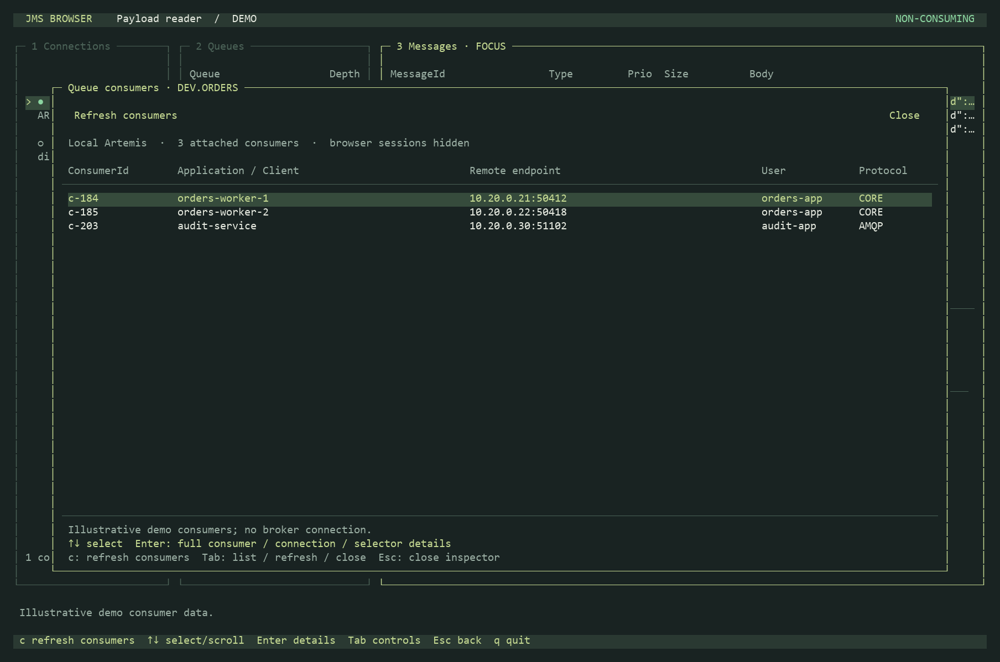
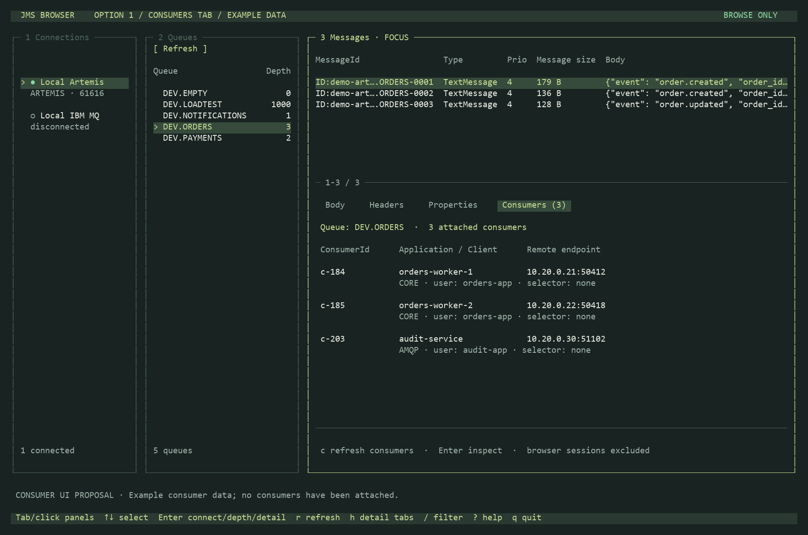
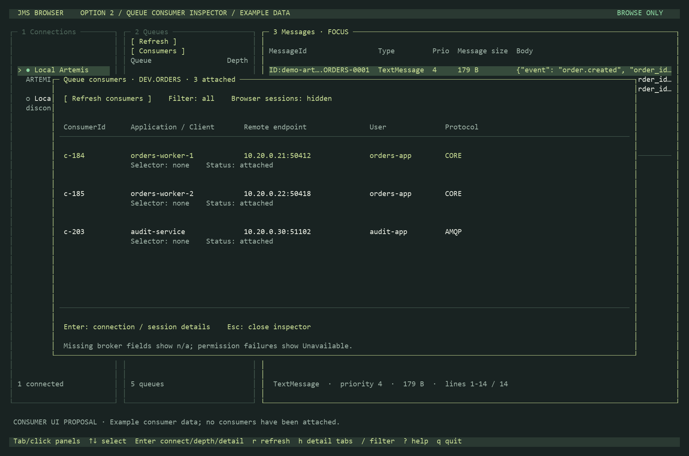
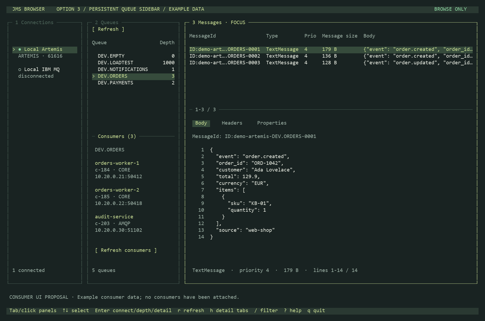

# Queue consumer display options

**Option 2 is implemented.** Use `c` to open it, press `c` again to
refresh metadata, Enter for full details, and Escape to return. It works on empty
queues and preserves the browser's selection. Tab cycles the list, refresh and
close controls. Mouse selection, double-click details and scrolling are supported.
The queue panel's buttons have been removed; the bottom bar shows `c consumers`
and `r refresh`. Inside the inspector, `r` has no action.

Implemented inspector with illustrative demo consumers:

[Actual Artemis inspector with no attached consumers](designs/consumers-implemented-empty.png).

The original proposals below use illustrative consumer identities and addresses.
No consumers were attached to the local queues to create these screenshots.
The application's Headers, Properties and Body tabs remain available independently,
with Headers selected by default.

## 1. Consumers tab — recommended

Add a fixed-position **Consumers (3)** tab next to Body, Headers and Properties.
It replaces detail content with a queue-level consumer list while preserving
the message table and the three-panel layout. Show ConsumerId, application/client,
remote endpoint, protocol and user when the broker provides them.

This is the smallest layout change and works well for occasional checks. The
consumer view must remain available when a queue has no messages: it belongs to
the selected queue, not the selected message. It follows existing click and
expanded-detail Tab navigation. Showing consumers temporarily hides the payload.

## 2. Queue consumer inspector — selected and implemented

The original button-based proposal now uses the `c` shortcut. Open a wide
inspector over the browser, with one row per consumer and space for
full IDs, endpoints, client/user identities, protocol and selector details.
Escape returns to the original selection.

This provides the most room for many consumers and long connection identifiers.
It introduces an extra open/close step and temporarily covers the normal browser.

## 3. Persistent queue sidebar

Reserve the lower part of section 2 for consumers of its selected queue. Show
application/client name, a short consumer ID, protocol and endpoint. Keep the
message list and payload visible on the right at all times.

This is useful for continuously watching a small set of consumers. It reduces
the visible queue list, and long names or numerous consumers need a larger view.
The existing Up/Down keys continue to select queues.

## Broker metadata and display rules

Artemis exposes queue consumer count and a `listConsumersAsJSON` management
operation. Additional connection/session queries can supply fields as available.
[Artemis QueueControl API](https://artemis.apache.org/components/artemis/documentation/javadocs/javadoc-latest/org/apache/activemq/artemis/api/core/management/QueueControl.html)

IBM MQ exposes queue handle status, including filtering handles opened for input.
For IBM, label the count as **input handles**, rather than assuming each handle
represents a unique application or thread. Connection/process details depend on
the queue manager and granted inquiry permissions.
[IBM MQ Administration Reference](https://public.dhe.ibm.com/software/integration/wmq/docs/V9.4/PDFs/mq94.refadmin.pdf)

For every design, distinguish **0 attached**, **loading**, and **unavailable**.
Exclude browser-only and internal PCF-reply activity from business-consumer views.
Show `n/a` for unavailable fields; do not invent throughput or activity metrics.
Consumer refresh should be explicit, preserve selection, and discard results for
a previously selected queue. Reading consumer metadata must not receive messages.
