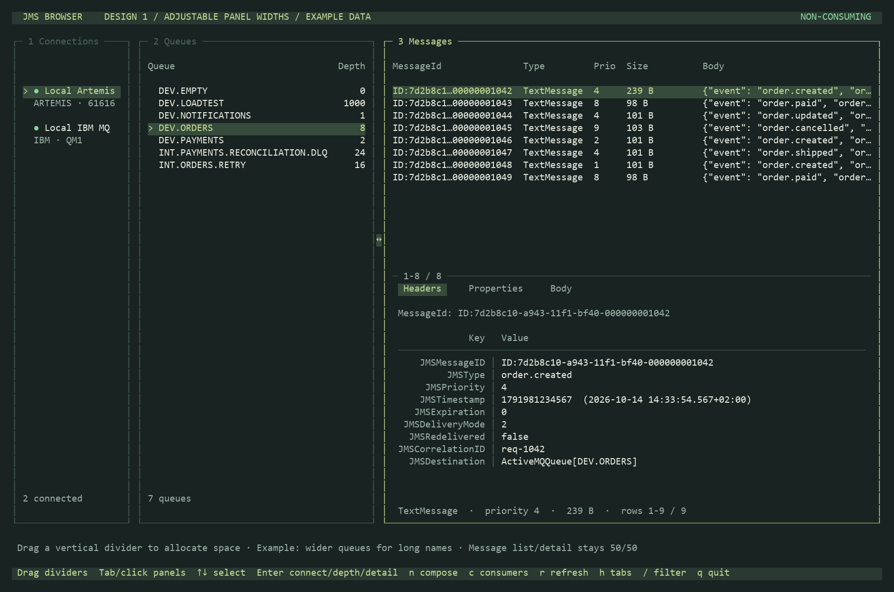
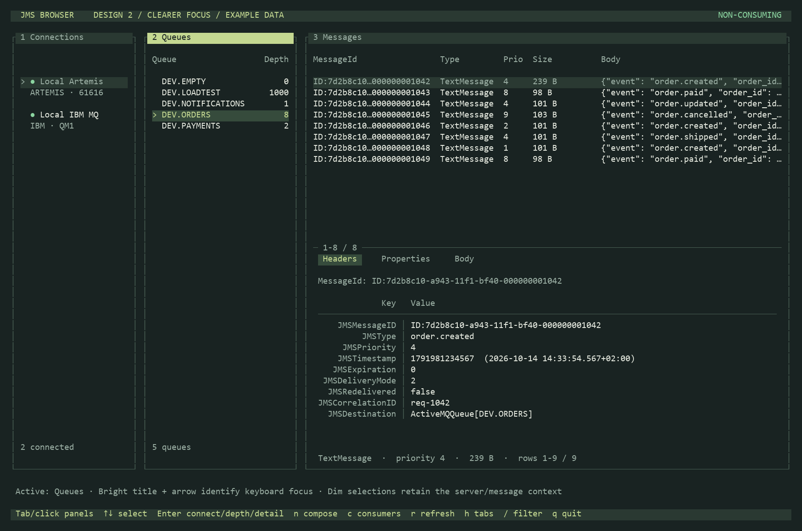
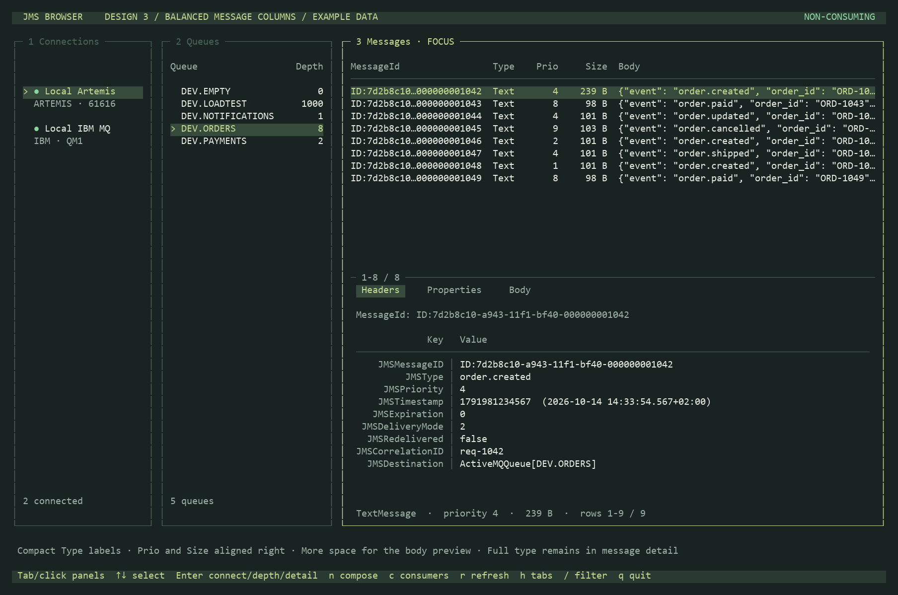
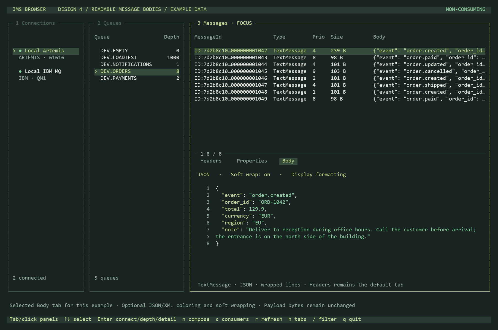
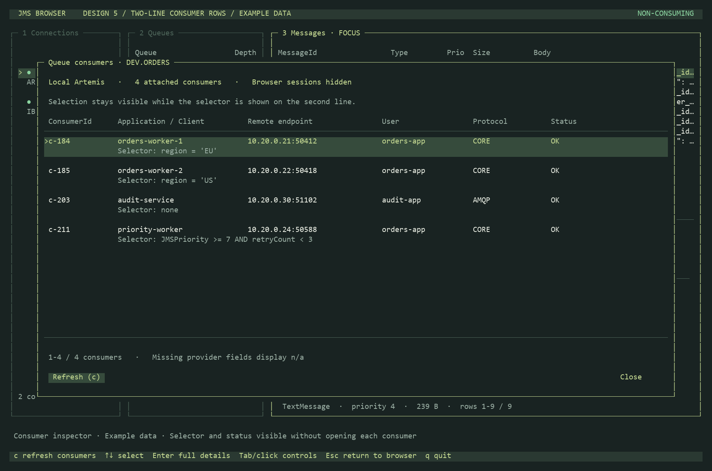
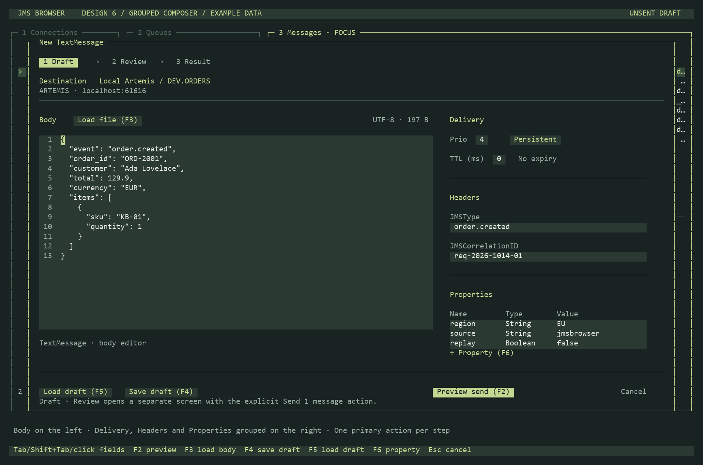

# Six design improvements

These layouts use illustrative data, rendered from the same character grid as
the curses application. **Options 1, 2 and 4 are now implemented.** Options 3, 5
and 6 remain proposals. The original proposal screenshots are retained below.

The implemented interface can be previewed in
[the combined body reader example](designs/body-wrap-implemented.png) and
[the queue-focus example](designs/panels-focus-implemented.png).

All options retain Tab/click panel navigation, Up/Down list navigation, Headers
as the default detail tab, Headers / Properties / Body ordering, the 50/50
message list/detail split, and the existing `c` / `r` shortcuts. Body is selected
in option 4 only to demonstrate its presentation. There are no buttons added to
the queue panel.

## 1. Adjustable panel widths

Drag the vertical dividers to give space to long queue names or message previews.
The screenshot allocates extra width to the queue panel. The message list/detail
height ratio stays fixed at 50/50.

Tradeoff: widening one panel reduces the room available to its neighbours.



## 2. Clearer focus

Use a bright title for the active panel and a quieter selection in inactive
panels. Keep an arrow on the active row so focus does not rely on color alone.
The screenshot has keyboard focus in Queues.

Tradeoff: the active title has stronger contrast than the current border style.



## 3. Balanced message columns — recommended first

Show compact Type labels such as Text or Bytes, align Prio and Size to the right,
and reduce their reserved width. Body gets the recovered space. The full message
type stays visible in the detail section. Column order stays MessageId, Type,
Prio, Size, Body.

Tradeoff: Type is abbreviated in the list. Full message IDs still require detail
view when they exceed the available column width.



## 4. Readable message bodies

Add optional soft wrapping and JSON/XML syntax coloring in both the embedded
and expanded Body view. Keep original line numbers, use a continuation marker
for wrapped lines, and show which display mode is selected. This is display
formatting; it does not change the stored payload.

Tradeoff: wrapped lines occupy more vertical space. Keep an unwrapped mode for
logs and other column-oriented text.



## 5. Two-line consumer rows

Show identity, application, endpoint, user, protocol and status on the first
line, with the selector on the second. Enter still opens all available details;
`c` refreshes. Provider fields that are unavailable show n/a. Keep IBM input
handle terminology when displaying IBM MQ metadata.

Tradeoff: fewer consumers fit on one screen than in a single-line table.



## 6. Grouped composer

Keep the body editor on the left. Group Delivery, Headers and Properties in a
right sidebar. Show Draft → Review → Result progression, and emphasize Preview
as the primary draft action. The existing explicit Send action remains on the
separate review screen.

Tradeoff: the sidebar reduces the body editor width. Long bodies may require
horizontal scrolling.



## Design references

The proposals adapt these ideas to a terminal interface rather than copying
their graphical widgets:

- [Carbon data table style](https://v10.carbondesignsystem.com/components/data-table/style/):
  content-dependent column widths, distinct interaction states, and taller rows
  when data needs two lines support options 2, 3 and 5.
- [Libadwaita style classes](https://gnome.pages.gitlab.gnome.org/libadwaita/doc/1.9/style-classes.html):
  accent treatment distinguishes a primary action, as proposed for option 6.

## Re-render

```powershell
.\.venv\Scripts\python.exe tools/render_design_options.py
```

Pillow is needed only for PNG export. The script does not connect to a broker,
attach consumers, or send messages.
